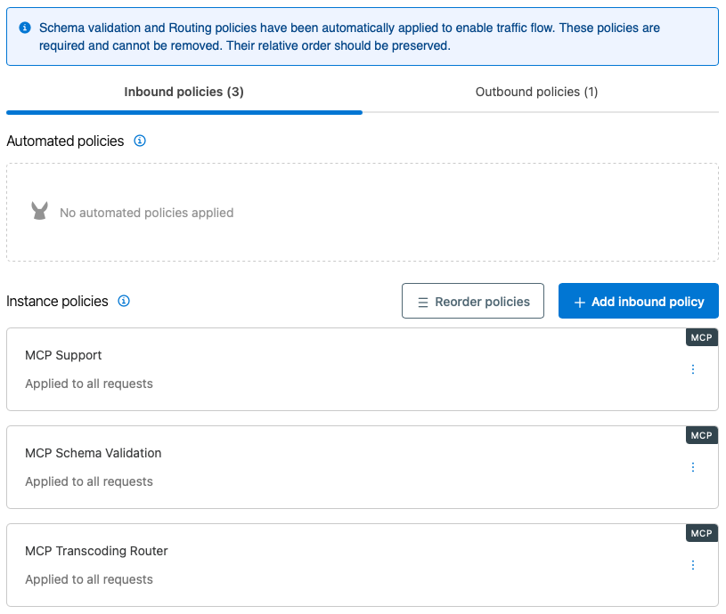
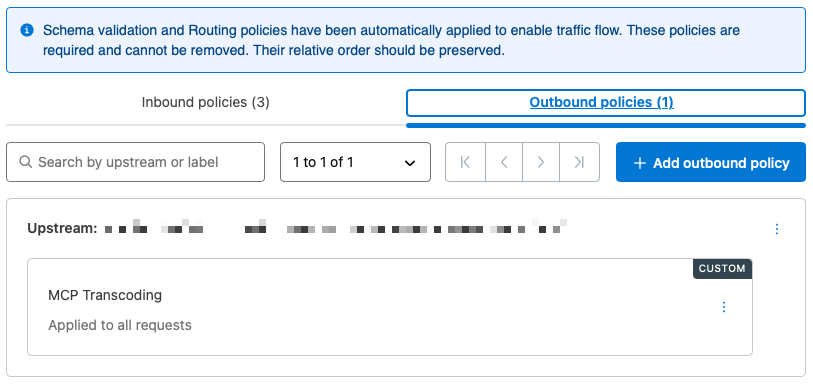
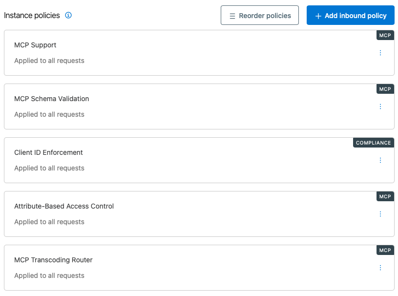

# MCP Governance with MuleSoft Omni Gateway

## Overview

This document summarizes the MCP management and governance experiments performed with Anypoint Omni Gateway and MuleSoft MCP Bridge using the Brilliant Mule Service Desk API, including key insights gained during the process. The experiments explored the baseline MCP policy stack and how selected MCP governance policies affect tool discovery, invocation, authorization, response optimization, progressive disclosure, and PII handling.

The experiments were intentionally performed incrementally, generally changing one policy or policy setting at a time and validating the resulting behavior using MCP Inspector and Witsy as MCP clients.

## Important Finding: OpenAPI Operation IDs and MCP Tool Names

The OpenAPI Specification for the Brilliant Mule Service Desk API is generated bottom-up from the Spring Boot implementation. Initially, the `@Operation` annotations did not explicitly specify `operationId` values, so the OpenAPI generator derived operation IDs from the Java method names. When exposed through MCP Bridge, the corresponding MCP tools were exposed with normalized snake_case names. For example:

- OpenAPI `operationId`: `addIncidentComment`
- MCP tool name: `add_incident_comment`

This difference became significant while experimenting with the **MCP Tool Mapping Policy**. The policy could expose a mapped client-facing tool name using the camelCase OpenAPI `operationId`, but tool invocation failed when it mapped the request back. To eliminate the mismatch, the implementation was updated to include `@Operation` annotations that explicitly align each OpenAPI `operationId` with its intended MCP tool name:

| Java Method          | OpenAPI `operationId` / MCP Tool Name |
| -------------------- | ------------------------------------- |
| `getIncidents`       | `list_incidents`                      |
| `getIncident`        | `get_incident`                        |
| `createIncident`     | `create_incident`                     |
| `updateIncident`     | `update_incident`                     |
| `assignIncident`     | `assign_incident`                     |
| `addIncidentComment` | `add_incident_comment`                |
| `resolveIncident`    | `resolve_incident`                    |
| `deleteIncident`     | `delete_incident`                     |

After regenerating the OpenAPI Specification and redeploying the API, MCP Tool Mapping worked successfully end-to-end.

> [!IMPORTANT]
> When using MCP Bridge, OpenAPI `operationId` values should be explicitly aligned with the intended MCP tool names. Allowing the OpenAPI generator to produce camelCase operation IDs while MCP Bridge exposes normalized snake_case tool names can cause MCP policies such as MCP Tool Mapping to fail during tool invocation.

## Baseline MCP Policy Stack

MCP Bridge lets you expose existing APIs through MCP without changing the underlying API implementation or deployment model. It is delivered as a pre-configured set of automated policies on MuleSoft Omni Gateway (formerly known as Flex Gateway) and configured through a guided experience in API Manager.

When the Brilliant Mule Service Desk API was exposed through MCP Bridge, the following baseline inbound policies were automatically applied.

1. MCP Support
2. MCP Schema Validation
3. MCP Transcoding Router

MCP Schema Validation and MCP Transcoding Router are required policies, and their relative order must be preserved.

Additionally, the following baseline outbound policy was automatically applied:

- MCP Transcoding

Together, these inbound and outbound policies provide MCP protocol support, schema validation, and MCP-to-REST routing that MCP Bridge requires.



*Baseline inbound policies automatically applied when exposing the Service Desk API through MCP Bridge.*



*Baseline outbound policy applied to the Service Desk API.*

### MCP Support Policy

The [MCP Support Policy](https://docs.mulesoft.com/gateway/latest/policies-included-mcp-support) offers protocol-level support necessary for MCP traffic.

**Policy version tested:** `1.1.1`

> [!WARNING]
> The **MCP Support Policy** must come first in the inbound policy order.

This policy includes an optional setting, **Inject MCP Element Headers**. When this setting is enabled, MCP element information is injected into downstream requests using headers such as:

- `x-ms-mcp-element-id`
- `x-ms-mcp-element-type`

Header injection was reviewed but deemed unnecessary for the governance experiments described in this document.

### MCP Schema Validation Policy

The [MCP Schema Validation Policy](https://docs.mulesoft.com/gateway/latest/policies-included-mcp-schema-validation) validates that incoming requests comply with the JSON-RPC MCP protocol. When **Validate Tool Schema** is enabled, the policy also validates tool invocation request parameters against the tool’s JSON Schema and serves `tools/list` from the trusted tool set without sending the request to the upstream MCP server.

**Policy version tested:** `1.2.0`

> [!NOTE]
> Although the **MCP Schema Validation Policy** is required, some MCP policies must be positioned before it, as specified in the individual policy documentation. For example, the **MCP Tools Progressive Disclosure Policy** must be positioned after **MCP Support** and before **MCP Schema Validation**.

The policy also provides optional tool poisoning detection capabilities that can evaluate `tools/list` responses against a pinned trusted tool set. Available detection types include:

- Descriptor Drift Detection
- Shadow Tool Name Detection
- Prompt Injection Detection
- Maximum Tools Per Response

The poisoning detection options were reviewed but were not enabled for these MCP Bridge experiments.

In an additional experiment, the **Validate Tool Schema** setting was disabled. With this setting disabled, MCP Inspector was unable to complete the `tools/list` operation. Restoring the setting re-enabled tool discovery.

> [!NOTE]
> **Observation:** With **Validate Tool Schema** enabled, the **MCP Schema Validation Policy** is integral to MCP Bridge tool discovery. Disabling it caused `tools/list` to fail, demonstrating that it is not merely optional request validation in this configuration.

### MCP Transcoding Policies

MCP Bridge uses complementary inbound and outbound transcoding policies to translate between MCP and the underlying REST API.

- The inbound **MCP Transcoding Router Policy** routes and transcodes MCP requests to the configured REST upstream based on the MCP tools and upstream routes configured through MCP Bridge.
  - **Policy version tested:** `1.0.1`
- The outbound **MCP Transcoding Policy** provides the corresponding outbound transcoding required to return the REST API response through the MCP interface.
  - **Policy version tested:** `1.0.0`

> [!WARNING]
> The **MCP Transcoding Router Policy** must come last in the inbound policy order.

For the Brilliant Mule Service Desk API, the **MCP Transcoding Router Policy** was configured with:

- MCP endpoint path: `/mcp`
- Upstream: Brilliant Mule Service Desk API
- Eight configured tools
- No resources
- No prompts

## MCP Management and Governance Policies

### MCP Attribute-Based Access Control

The [MCP Attribute-Based Access Control Policy](https://docs.mulesoft.com/gateway/latest/policies-included-mcp-attribute-access-control) uses the [Cedar policy language](https://docs.cedarpolicy.com) to define access rules for MCP tools, resources, and prompts based on authenticated user information.

**Policy version tested:** `1.0.2`

The policy requires an authentication policy to be applied before the **MCP Attribute-Based Access Control Policy**. For this experiment, the **Client ID Enforcement Policy** was used for authentication.



*Inbound policy order used for the MCP Attribute-Based Access Control experiment.*

The initial Cedar rule permitted calls only to `list_incidents`:

```cedar
permit(principal, action == Action::"tools/call", resource == Tool::"list_incidents");
```

The experiment produced the following behavior:

- `list_incidents` remained callable.
- `get_incident` remained discoverable but invocation was denied.
- The complete eight-tool catalog remained visible through `tools/list`.

This behavior differs from the **MCP Global Access Policy**, which removed a blocked tool from discovery.

> [!NOTE]
> **Finding:** The **MCP Attribute-Based Access Control Policy** can selectively authorize tool invocation using Cedar rules. A tool permitted by the policy can be invoked successfully, while other discovered tools are denied with an access-denied response. Unlike the **MCP Global Access Policy**, this ABAC configuration does not remove unauthorized tools from tool discovery.

### MCP Global Access

The [MCP Global Access Policy](https://docs.mulesoft.com/gateway/latest/policies-included-mcp-global-access) controls which MCP tools, resources, and prompts are available to clients. Access rules can allow or block specific items based on tool or prompt names or resource URIs. The policy applies these rules to both MCP discovery responses and invocation requests.

**Policy version tested:** `1.0.1`

For this experiment, the policy was tested by blocking the `delete_incident` tool. The policy was configured with:

- Rule: Block
- Match type: literal
- Value: `delete_incident`

During the initial experiment, `delete_incident` remained visible in `tools/list`, but attempting to invoke the tool was denied. This experiment occurred before the OpenAPI `operationId` values were explicitly aligned with the MCP tool names. After aligning the OpenAPI `operationId` values and retesting tool discovery, `delete_incident` was no longer present in `tools/list`. Other tools remained discoverable and callable. Invocation of `delete_incident` was not retested after this change.

> [!NOTE]
> **Finding:** The **MCP Global Access Policy** demonstrated control over both tool invocation and tool discovery. During testing, `delete_incident` was denied when invoked, and after the OpenAPI `operationId` values were aligned with the MCP tool names, the blocked tool was excluded from the tool catalog.

### MCP Payload Optimization

The [MCP Payload Optimization Policy](https://docs.mulesoft.com/gateway/latest/policies-included-mcp-payload-optimization) reduces LLM token consumption by transforming MCP tool responses before they are returned to the client.

**Policy version tested:** `1.2.1`

The policy provides three categories of optimization:

- **Clean Payloads** removes structural noise and unnecessary data, including HTML, base64-encoded data, null values, and excessive whitespace.
- **Smart Response Trimming** uses a model proxy to reduce large responses based on the agent's declared intent.
- **Compress Repeated Structures** converts eligible repeated JSON structures into Token-Oriented Object Notation (TOON).

For these experiments, the policy was tested against `list_incidents`, which returns a relatively large response containing repeated incident and comment structures.

#### Remove Nulls

The first experiment enabled only **Remove Nulls**. The response contained the following field on INC-1001:

```json
"assignedTo": null
```

The field remained present after applying the policy. The minimum response size was subsequently changed to `0` to eliminate the response-size threshold as a possible explanation, but the result was unchanged.

> [!NOTE]
> **Observation:** The MuleSoft documentation states that **Remove Nulls** removes JSON fields whose value is null. However, enabling **Remove Nulls** alone did not remove the `assignedTo: null` field from the `list_incidents` response in this environment, even after the minimum response size was set to `0`. The reason for this behavior has not yet been established.

#### Compress Repeated Structures

A separate experiment disabled the other transformations and enabled **Compress Repeated Structures**.

The `list_incidents` response was successfully transformed from JSON into Token-Oriented Object Notation (TOON). Repeated structures such as incident comments were represented compactly. For example, the 30 comments associated with INC-1013 were represented using a structure similar to `comments[30]{author,text,createdAt}:` rather than repeating the JSON property names for every comment.

The transformation preserved the response content while reducing structural repetition.

> [!NOTE]
> **Finding:** The **MCP Payload Optimization Policy** successfully transformed the eligible `list_incidents` response using **Compress Repeated Structures**. The large JSON response was encoded as TOON, reducing structural repetition while preserving the response content.

### MCP PII Detector

The [MCP PII Detector Policy](https://docs.mulesoft.com/gateway/latest/policies-included-mcp-pii-detector) detects personally identifiable information (PII) in MCP JSON-RPC traffic on both the request and response sides. The policy recursively inspects string values in request parameters and response results and can be configured to reject traffic, log detected PII, or log and mask detected PII.

**Policy version tested:** `1.0.1`

For these experiments, the policy was tested using fictitious PII deliberately included in the Service Desk test data. INC-1012 contains a comment with the test SSN:

```text
000-12-3456
```

The policy was configured to detect **US SSN** without any custom PII pattern.

#### Log and Mask

With the action set to **Log and Mask**, `get_incident` was invoked for INC-1012. The call succeeded, but the SSN embedded inside the nested `comments[].text` value was transformed from `000-12-3456` to `***-**-*456`. The remainder of the incident response was preserved.

This confirmed that the policy recursively inspected nested MCP response content rather than limiting detection to top-level fields.

#### Reject

The action was then changed to **Reject** without changing the tool or test data. The incident response was blocked. MCP Inspector surfaced a tool error whose data identified:

- PII type: `SSN`
- Masked value: `***-**-*456`
- Phase: `response`
- Policy: `mcp-pii-detector`
- Reason: `policy_pii_detected`

The original SSN was not exposed in the error.

MCP Inspector represented the rejected tool call as a JSON-RPC internal error rather than displaying the underlying HTTP rejection directly.

> [!NOTE]
> **Finding:** The **MCP PII Detector Policy** successfully detected PII within nested MCP response content. With **Log and Mask**, the detected SSN was masked while the remainder of the response was preserved. With **Reject**, the response was blocked and MCP Inspector received an error identifying the PII finding without exposing the original value.

### MCP Tool Mapping

The [MCP Tool Mapping Policy](https://docs.mulesoft.com/gateway/latest/policies-included-mcp-tool-mapping) transforms MCP tool names and descriptions exposed to clients. The policy applies mappings bidirectionally: it transforms tool names in `tools/list` responses and reverse-maps those names in `tools/call` requests before forwarding them to the backend.

**Policy version tested:** `1.0.2`

The policy supports literal mappings for individual tool names and regular expression mappings for pattern-based transformations. For this experiment, a literal mapping was applied to `add_incident_comment`:

| Setting            | Value                                                                                                       |
| ------------------ | ----------------------------------------------------------------------------------------------------------- |
| Source tool        | `add_incident_comment`                                                                                      |
| Mapped tool        | `add_comment_to_incident`                                                                                   |
| Mapped description | `Adds a comment to an incident. Provide the incident ID and a body containing the comment author and text.` |

The initial experiment exposed the OpenAPI `operationId` and MCP tool name mismatch described earlier in [Important Finding: OpenAPI Operation IDs and MCP Tool Names](#important-finding-openapi-operation-ids-and-mcp-tool-names). Although the policy transformed the client-facing tool name to `add_comment_to_incident`, invocation failed because the reverse-mapped `tools/call` request used `addIncidentComment`, which was not present in the MCP tool list.

After explicitly aligning the OpenAPI `operationId` with the MCP tool name as `add_incident_comment`, the same mapping worked end-to-end. MCP Inspector discovered `add_comment_to_incident`, and invoking the mapped tool successfully reached the underlying REST operation.

The mapping changed the client-facing tool name and description while preserving the tool's original input schema.

> [!NOTE]
> **Finding:** The **MCP Tool Mapping Policy** worked as expected once the OpenAPI `operationId` was explicitly aligned with the MCP tool name. The experiment also demonstrated the policy's bidirectional behavior: the mapped name was exposed through tool discovery and reverse-mapped during tool invocation.

### MCP Tools Progressive Disclosure

The [MCP Tools Progressive Disclosure Policy](https://docs.mulesoft.com/gateway/latest/policies-included-mcp-progressive-disclosure) reduces the MCP client's context-window token consumption by hiding the full tool catalog behind two meta-tools:

- `search_tools`: Finds relevant tools on demand by matching a query against tool names and descriptions.
- `invoke_tool`: Invokes a tool discovered through `search_tools`.

**Policy version tested:** `1.0.2`

> [!WARNING]
> The **MCP Tools Progressive Disclosure Policy** must be positioned after the **MCP Support Policy** but before other MCP policies that operate on tool names, including access control, tool mapping, and schema validation policies.

The baseline configuration used:

| Setting               | Value  |
| --------------------- | ------ |
| Search Result Limit   | `20`   |
| Hot Tools             | None   |
| Meta-Tool Name Prefix | None   |

#### Policy Ordering

The policy is order-sensitive. During the initial experiment, when the policy was positioned later in the policy chain, MCP Inspector continued to receive the normal eight-tool catalog.

After positioning the **MCP Tools Progressive Disclosure Policy** immediately after the **MCP Support Policy**, `tools/list` exposed only:

- `search_tools`
- `invoke_tool`

The policy handles these meta-tools while preserving the underlying tool identities for downstream policies. A `search_tools` call is resolved against the upstream tool catalog, while an `invoke_tool` call is rewritten as a native `tools/call` request using the underlying tool name. This allows downstream policies to continue operating on the actual tools rather than the progressive-disclosure meta-tools.

#### Tool Search

The `search_tools` meta-tool was used to locate an underlying tool.

Search behavior was sensitive to query wording:

- `comment incident` returned no results.
- `comment` returned `add_incident_comment`.

The policy documentation defines the query as a case-insensitive regular expression matched against tool names and descriptions. The reason `comment` and `comment incident` produced different results in this experiment was not investigated further.

#### Tool Invocation

The `invoke_tool` meta-tool successfully invoked `list_incidents`, demonstrating that a tool hidden from the initial catalog could still be invoked through progressive disclosure.

#### Hot Tools

`list_incidents` was then configured as a Hot Tool. Hot Tools bypass progressive disclosure and remain directly available through `tools/list`.

After reconnecting, the initial tool catalog contained:

- `search_tools`
- `invoke_tool`
- `list_incidents`

The Hot Tool retained its original description and complete input schema, while the remaining Service Desk tools stayed behind progressive disclosure.

> [!NOTE]
> **Finding:** The **MCP Tools Progressive Disclosure Policy** reduced the initially exposed MCP tool catalog by replacing non-Hot Tools with the `search_tools` and `invoke_tool` meta-tools. Tools could then be discovered and invoked on demand, while configured Hot Tools remained directly exposed with their original schemas. The experiment also confirmed the importance of policy ordering: the policy must precede downstream policies that operate on the underlying tool names. Tool search was sensitive to query wording; in testing, `comment` located `add_incident_comment`, while `comment incident` returned no results.

## Conclusions

The experiments demonstrated that Omni Gateway can apply governance controls across multiple distinct aspects of an MCP interface created using MCP Bridge:

- Tool visibility can be managed independently from tool invocation authorization.
- Client-facing tool names and descriptions can be modified without altering the underlying REST operation.
- Cedar-based authorization enables selective control over tool invocation.
- Large MCP responses can be transformed into more compact representations, such as TOON.
- Progressive disclosure substantially reduces the schemas exposed during initial tool discovery while preserving on-demand access to the underlying tools.
- Personally identifiable information (PII) can be detected recursively in MCP responses and either masked or used to block the response.

The experiments also identified several implementation details that are important when constructing MCP Bridge demonstrations or production configurations:

- Explicitly align OpenAPI `operationId` values with the intended MCP tool names.
- Maintain required policy ordering and adhere to the documented placement requirements for the **MCP Tools Progressive Disclosure Policy**.
- When validating tool discovery after policy changes, allow time for policy propagation and reconnect the MCP client as needed.
- Treat unexpected policy behavior as an experimental result rather than presuming policy ineffectiveness. The Remove Nulls behavior remains intentionally documented as unresolved.

These results establish a practical governance baseline for the Brilliant Mule Service Desk MCP implementation and provide a foundation for subsequent experiments in authorization, data governance, native MCP server development, and agent-to-agent interactions.
